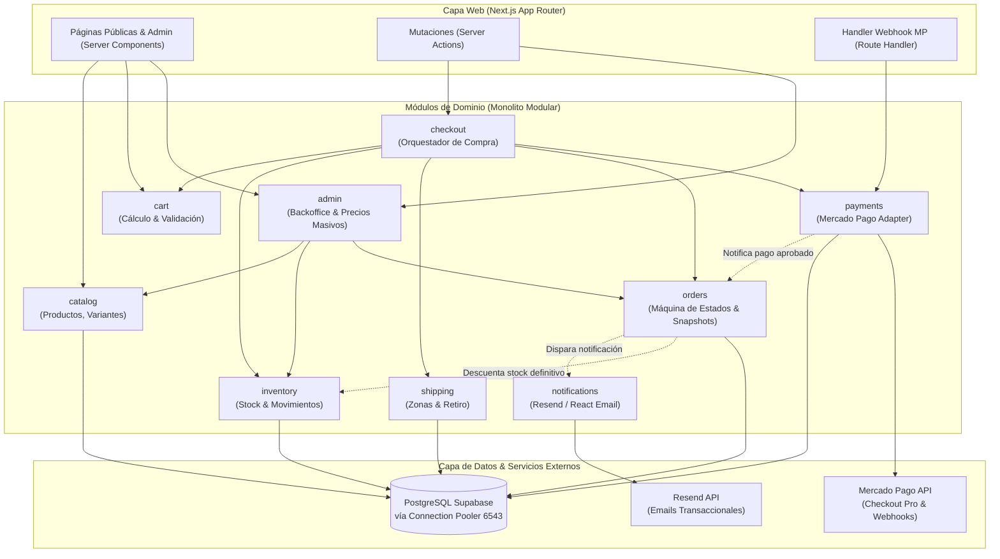
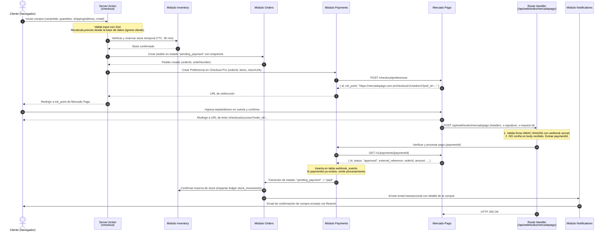

# Arquitectura del Sistema - BX Boutique

Este documento define la estructura técnica del monolito modular de BX Boutique, los límites entre módulos, el flujo de datos para compras y la gestión de fallos.

---

## 1. Módulos y Responsabilidades

El sistema sigue el principio de **Monolito Modular**: un único despliegue con límites de dominio estrictos. Cada módulo es autónomo y expone sus capacidades únicamente a través de su archivo `contracts.ts`.

| Módulo              | Responsabilidad Principal                                                                                                       | Dependencias Permitidas                                           |
| ------------------- | ------------------------------------------------------------------------------------------------------------------------------- | ----------------------------------------------------------------- |
| **`catalog`**       | Gestión de productos, variantes (talle/color), categorías e imágenes. Consultas optimizadas para lectura.                       | Ninguna (módulo base).                                            |
| **`inventory`**     | Seguimiento de stock físico, reservas temporales y auditoría de movimientos (`stock_movements`).                                | `catalog` (solo referencias a IDs de variantes).                  |
| **`cart`**          | Representación del carrito del cliente invitado (almacenamiento en cookie/cliente) y validación de estructura.                  | `catalog` (para enriquecer ítems con datos vigentes).             |
| **`shipping`**      | Cálculo de costos de envío según código postal/zona y reglas de retiro en el local físico.                                      | Ninguna.                                                          |
| **`checkout`**      | Orquestador de la compra: valida stock, congela precios, calcula totales finales y genera la preferencia de Mercado Pago.       | `cart`, `catalog`, `inventory`, `shipping`, `orders`, `payments`. |
| **`payments`**      | Integración con Mercado Pago Checkout Pro: creación de preferencias, recepción y verificación criptográfica de webhooks.        | Ninguna (infraestructura pura de pago).                           |
| **`orders`**        | Ciclo de vida del pedido: máquina de estados, persistencia de snapshots históricos (`order_items`) y numeración secuencial.     | `payments` (para registrar el ID de cobro).                       |
| **`notifications`** | Despacho de emails transaccionales mediante Resend y plantillas construidas con React Email.                                    | Ninguna (recibe DTOs serializables con datos de la orden).        |
| **`admin`**         | Backoffice privado: autenticación con Supabase Auth + MFA, dashboard de métricas, edición masiva de precios y gestión de stock. | `catalog`, `orders`, `inventory`.                                 |

---

## 2. Diagrama de Dependencias y Componentes

---

## 3. Flujo Principal de Compra: Checkout → Pago → Webhook → Confirmación

Este es el recorrido crítico de extremo a extremo desde que el cliente pulsa "Iniciar Pago" hasta la confirmación de la orden.

---

## 4. Gestión Exhaustiva de Casos de Fallo

En el comercio electrónico, los fallos son la norma y no la excepción. A continuación se detalla cómo el sistema maneja de forma determinista cada escenario anómalo:

### Caso A: Pago Rechazado o Cancelado por el Usuario

- **Comportamiento:** Mercado Pago redirige al cliente a `/checkout/pending` o `/checkout/failure` según corresponda. Paralelamente, el webhook recibe el estado `rejected` o `cancelled`.
- **Acción:**
  1. El módulo `orders` no avanza el estado a `paid`.
  2. El pedido permanece en `payment_failed` o `pending_payment` según si permite reintentar el pago.
  3. El cliente ve una pantalla explicativa clara invitándolo a reintentar con otro medio de pago.
  4. La reserva de stock se libera inmediatamente si la orden fue explícitamente cancelada, o expira automáticamente si no hay nuevo intento antes del TTL.

### Caso B: Webhook Duplicado o Reintentado

- **Comportamiento:** Mercado Pago reintenta el envío de webhooks múltiples veces ante lentitudes o respuestas HTTP 5xx.
- **Acción:**
  1. Al recibir el webhook, se consulta la tabla `webhook_events` buscando `provider_payment_id`.
  2. Si el registro ya existe con estado `processed`, el handler responde inmediatamente `HTTP 200 OK` sin ejecutar ninguna lógica de negocio repetida ni reenviar emails.
  3. La base de datos cuenta con una restricción `UNIQUE (provider_payment_id)` en la tabla `payments` para garantizar la idempotencia incluso si dos webhooks llegan exactamente en el mismo milisegundo en hilos paralelos.

### Caso C: El Webhook llega antes de que el Cliente sea Redirigido

- **Comportamiento:** En conexiones móviles lentas, Mercado Pago puede procesar el pago y disparar el webhook antes de que el navegador del usuario complete la redirección a `/checkout/success`.
- **Acción:**
  1. El webhook procesa el pago de forma completamente desacoplada de la sesión del usuario.
  2. Cuando el usuario finalmente aterriza en `/checkout/success?order_id=...`, la página (Server Component) lee el estado directamente de PostgreSQL.
  3. Si la orden ya está en estado `paid`, muestra la pantalla de agradecimiento con el resumen definitivo. Si el webhook aún no terminó, la pantalla muestra un estado "Confirmando tu pago..." con un polling ligero de 3 segundos para refrescar la vista.

### Caso D: Stock Agotado durante el Proceso de Pago (Condición de Carrera)

- **Problema:** Un usuario abrió Checkout Pro, demoró 25 minutos en ingresar su tarjeta y otro usuario compró la última unidad disponible mientras tanto.
- **Acción y Mitigación:**
  1. Se utiliza una reserva temporal de stock con TTL de 30 minutos al crear la preferencia de pago.
  2. Si el pago fue aprobado en Mercado Pago después de que la reserva expiró y el stock fue vendido a otro cliente:
     - El webhook detecta que `quantity` en inventario es 0 al intentar la deducción definitiva.
     - La orden se pasa al estado `stock_depleted_after_payment`.
     - **Reembolso automático:** El sistema invoca automáticamente la API de Mercado Pago (`POST /v1/payments/{id}/refunds`) para devolver el 100% del dinero al cliente.
     - Se dispara una alerta inmediata al canal de administración y un email al cliente explicando la situación con disculpas formales.

### Caso E: Reserva de Stock Expirada sin Concreción de Pago

- **Comportamiento:** El usuario abandonó el carrito en la pasarela de pago de Mercado Pago.
- **Acción:**
  1. La tabla `inventory` mantiene `quantity` (stock real físico) y `reserved_quantity`.
  2. Las reservas tienen un campo `expires_at`.
  3. Al consultar disponibilidad para nuevos clientes, el stock disponible es `quantity - sum(reservas_activas_no_expiradas)`.
  4. De este modo, una reserva abandonada queda automáticamente disponible para otros compradores tan pronto como se cumple el TTL, sin necesidad de procesos de limpieza en segundo plano (cron jobs) bloqueantes.

---

## 5. Decisiones Clave para Depuración (Debuggability)

- **Trace ID Unificado:** Cada petición genera un identificador único (`x-request-id`) que se propaga a los logs estructurados de Pino y se envía como `external_reference` a Mercado Pago. Si ocurre un problema con un cobro, buscar ese ID en los logs muestra el ciclo completo.
- **Sin Efectos Secundarios Ocultos:** No se utilizan triggers en base de datos para lógica de negocio. Toda mutación pasa por una función de caso de uso con tipado estricto y trazabilidad en código TypeScript.
- **Aislamiento de Errores con `Result<T, E>`:** Las operaciones de negocio no lanzan excepciones no controladas. Retornan `{ success: true, data }` o `{ success: false, error }`, permitiendo que el desarrollador vea exactamente en qué paso falló el flujo sin buscar en un stack trace genérico.
