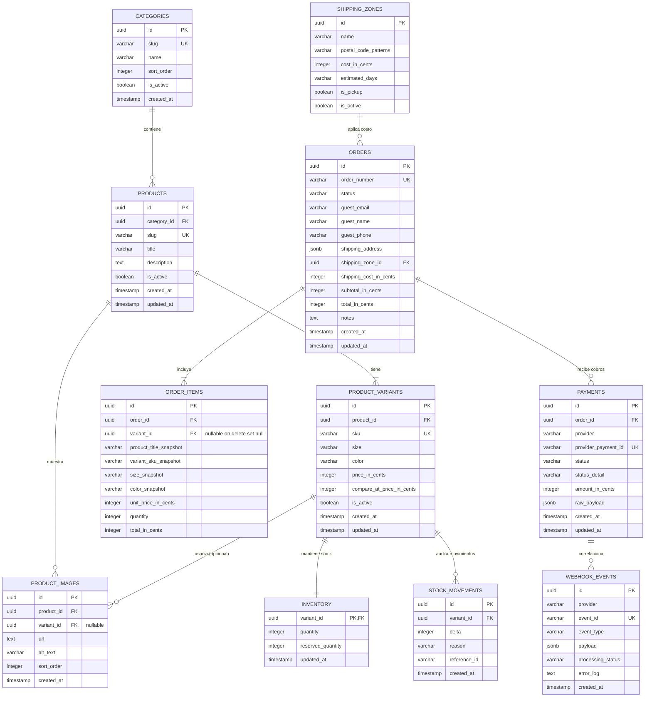

# Esquema y Modelo de Datos - BX Boutique

Este documento especifica el modelo relacional de datos implementado con **Drizzle ORM** sobre PostgreSQL en Supabase (región São Paulo), detallando tablas, restricciones, índices, el diagrama Entidad-Relación y los fundamentos de diseño.

> **Nota Pedagógica para desarrolladores C# / Java:**
> **Drizzle ORM** es el equivalente en el ecosistema TypeScript a una cruza entre **Entity Framework Core (usando Fluent API puro)** y **Dapper**. A diferencia de EF Core o Hibernate, Drizzle no tiene _change tracker_ en memoria ni proxy objects: lo que escribís en TypeScript se traduce 1 a 1 a SQL estándar sin magia oculta, con inferencia estricta de tipos en tiempo de compilación.

---

## 1. Diagrama Entidad-Relación (Mermaid)



---

## 2. Definición del Esquema en Drizzle ORM

A continuación se presenta el código TypeScript canónico que define las tablas y tipos del sistema:

```typescript
import {
  pgTable,
  uuid,
  varchar,
  text,
  integer,
  boolean,
  timestamp,
  jsonb,
  index,
  uniqueIndex,
} from 'drizzle-orm/pg-core';
import { relations } from 'drizzle-orm';

// ---------------------------------------------------------------------------
// 1. CATÁLOGO: Categorías, Productos, Variantes e Imágenes
// ---------------------------------------------------------------------------

export const categories = pgTable('categories', {
  id: uuid('id').primaryKey().defaultRandom(),
  slug: varchar('slug', { length: 100 }).notNull().unique(),
  name: varchar('name', { length: 100 }).notNull(),
  sortOrder: integer('sort_order').notNull().default(0),
  isActive: boolean('is_active').notNull().default(true),
  createdAt: timestamp('created_at', { withTimezone: true }).defaultNow().notNull(),
});

export const products = pgTable(
  'products',
  {
    id: uuid('id').primaryKey().defaultRandom(),
    categoryId: uuid('category_id')
      .references(() => categories.id, { onDelete: 'restrict' })
      .notNull(),
    slug: varchar('slug', { length: 150 }).notNull().unique(),
    title: varchar('title', { length: 200 }).notNull(),
    description: text('description').notNull().default(''),
    isActive: boolean('is_active').notNull().default(true),
    createdAt: timestamp('created_at', { withTimezone: true }).defaultNow().notNull(),
    updatedAt: timestamp('updated_at', { withTimezone: true }).defaultNow().notNull(),
  },
  (t) => [
    index('idx_products_category_id').on(t.categoryId),
    index('idx_products_is_active').on(t.isActive),
  ]
);

export const productVariants = pgTable(
  'product_variants',
  {
    id: uuid('id').primaryKey().defaultRandom(),
    productId: uuid('product_id')
      .references(() => products.id, { onDelete: 'cascade' })
      .notNull(),
    sku: varchar('sku', { length: 50 }).notNull().unique(),
    size: varchar('size', { length: 20 }).notNull(), // Ej: "S", "M", "L", "XL", "Único"
    color: varchar('color', { length: 50 }).notNull(), // Ej: "Negro", "Terracota", "Crudo"
    priceInCents: integer('price_in_cents').notNull(), // Dinero: entero en centavos
    compareAtPriceInCents: integer('compare_at_price_in_cents'), // Precio tachado / anterior
    isActive: boolean('is_active').notNull().default(true),
    createdAt: timestamp('created_at', { withTimezone: true }).defaultNow().notNull(),
    updatedAt: timestamp('updated_at', { withTimezone: true }).defaultNow().notNull(),
  },
  (t) => [
    index('idx_variants_product_id').on(t.productId),
    uniqueIndex('idx_variants_product_size_color').on(t.productId, t.size, t.color),
  ]
);

export const productImages = pgTable(
  'product_images',
  {
    id: uuid('id').primaryKey().defaultRandom(),
    productId: uuid('product_id')
      .references(() => products.id, { onDelete: 'cascade' })
      .notNull(),
    variantId: uuid('variant_id').references(() => productVariants.id, {
      onDelete: 'set null',
    }),
    url: text('url').notNull(),
    altText: varchar('alt_text', { length: 200 }).notNull(),
    sortOrder: integer('sort_order').notNull().default(0),
    createdAt: timestamp('created_at', { withTimezone: true }).defaultNow().notNull(),
  },
  (t) => [index('idx_product_images_product').on(t.productId, t.sortOrder)]
);

// ---------------------------------------------------------------------------
// 2. INVENTARIO: Stock y Ledger de Movimientos
// ---------------------------------------------------------------------------

export const inventory = pgTable('inventory', {
  variantId: uuid('variant_id')
    .primaryKey()
    .references(() => productVariants.id, { onDelete: 'cascade' }),
  quantity: integer('quantity').notNull().default(0), // Stock físico real en depósito
  reservedQuantity: integer('reserved_quantity').notNull().default(0), // Reservas temporales activas
  updatedAt: timestamp('updated_at', { withTimezone: true }).defaultNow().notNull(),
});

export const stockMovements = pgTable(
  'stock_movements',
  {
    id: uuid('id').primaryKey().defaultRandom(),
    variantId: uuid('variant_id')
      .references(() => productVariants.id, { onDelete: 'cascade' })
      .notNull(),
    delta: integer('delta').notNull(), // Positivo (ingreso) o negativo (venta)
    reason: varchar('reason', { length: 50 }).notNull(), // 'purchase', 'restock', 'manual_adjustment', 'refund'
    referenceId: varchar('reference_id', { length: 100 }), // ej: ID de orden o comprobante
    createdAt: timestamp('created_at', { withTimezone: true }).defaultNow().notNull(),
  },
  (t) => [index('idx_stock_movements_variant').on(t.variantId, t.createdAt)]
);

// ---------------------------------------------------------------------------
// 3. ENVÍOS Y ZONAS
// ---------------------------------------------------------------------------

export const shippingZones = pgTable('shipping_zones', {
  id: uuid('id').primaryKey().defaultRandom(),
  name: varchar('name', { length: 100 }).notNull(), // Ej: "CABA", "GBA Primer Cordón", "Interior", "Retiro en Local"
  postalCodePatterns: varchar('postal_code_patterns', { length: 255 })
    .notNull()
    .default('*'),
  costInCents: integer('cost_in_cents').notNull(), // 0 para retiro en local
  estimatedDays: varchar('estimated_days', { length: 50 }).notNull(), // Ej: "1 a 3 días hábiles"
  isPickup: boolean('is_pickup').notNull().default(false),
  isActive: boolean('is_active').notNull().default(true),
});

// ---------------------------------------------------------------------------
// 4. PEDIDOS Y SNAPSHOTS HISTÓRICOS
// ---------------------------------------------------------------------------

export const orderStatusEnum = [
  'pending_payment',
  'paid',
  'preparing',
  'shipped',
  'ready_for_pickup',
  'delivered',
  'cancelled',
  'refunded',
] as const;

export const orders = pgTable(
  'orders',
  {
    id: uuid('id').primaryKey().defaultRandom(),
    orderNumber: varchar('order_number', { length: 20 }).notNull().unique(), // Ej: "BX-1001"
    status: varchar('status', { length: 30, enum: orderStatusEnum })
      .notNull()
      .default('pending_payment'),
    guestEmail: varchar('guest_email', { length: 255 }).notNull(),
    guestName: varchar('guest_name', { length: 150 }).notNull(),
    guestPhone: varchar('guest_phone', { length: 50 }).notNull(),
    shippingAddress: jsonb('shipping_address').notNull(), // Calle, número, piso, depto, ciudad, CP, provincia
    shippingZoneId: uuid('shipping_zone_id')
      .references(() => shippingZones.id, { onDelete: 'restrict' })
      .notNull(),
    shippingCostInCents: integer('shipping_cost_in_cents').notNull(),
    subtotalInCents: integer('subtotal_in_cents').notNull(),
    totalInCents: integer('total_in_cents').notNull(),
    notes: text('notes'),
    createdAt: timestamp('created_at', { withTimezone: true }).defaultNow().notNull(),
    updatedAt: timestamp('updated_at', { withTimezone: true }).defaultNow().notNull(),
  },
  (t) => [
    index('idx_orders_status').on(t.status),
    index('idx_orders_email').on(t.guestEmail),
    index('idx_orders_created_at').on(t.createdAt),
  ]
);

export const orderItems = pgTable(
  'order_items',
  {
    id: uuid('id').primaryKey().defaultRandom(),
    orderId: uuid('order_id')
      .references(() => orders.id, { onDelete: 'cascade' })
      .notNull(),
    variantId: uuid('variant_id').references(() => productVariants.id, {
      onDelete: 'set null',
    }),
    productTitleSnapshot: varchar('product_title_snapshot', { length: 200 }).notNull(),
    variantSkuSnapshot: varchar('variant_sku_snapshot', { length: 50 }).notNull(),
    sizeSnapshot: varchar('size_snapshot', { length: 20 }).notNull(),
    colorSnapshot: varchar('color_snapshot', { length: 50 }).notNull(),
    unitPriceInCents: integer('unit_price_in_cents').notNull(),
    quantity: integer('quantity').notNull(),
    totalInCents: integer('total_in_cents').notNull(),
  },
  (t) => [index('idx_order_items_order_id').on(t.orderId)]
);

// ---------------------------------------------------------------------------
// 5. PAGOS Y AUDITORÍA DE WEBHOOKS (Mercado Pago)
// ---------------------------------------------------------------------------

export const payments = pgTable(
  'payments',
  {
    id: uuid('id').primaryKey().defaultRandom(),
    orderId: uuid('order_id')
      .references(() => orders.id, { onDelete: 'restrict' })
      .notNull(),
    provider: varchar('provider', { length: 30 }).notNull().default('mercadopago'),
    providerPaymentId: varchar('provider_payment_id', { length: 100 }).notNull().unique(),
    status: varchar('status', { length: 50 }).notNull(), // 'approved', 'pending', 'rejected', 'refunded'
    statusDetail: varchar('status_detail', { length: 100 }), // ej: 'accredited', 'cc_rejected_insufficient_amount'
    amountInCents: integer('amount_in_cents').notNull(),
    rawPayload: jsonb('raw_payload'),
    createdAt: timestamp('created_at', { withTimezone: true }).defaultNow().notNull(),
    updatedAt: timestamp('updated_at', { withTimezone: true }).defaultNow().notNull(),
  },
  (t) => [index('idx_payments_order_id').on(t.orderId)]
);

export const webhookEvents = pgTable('webhook_events', {
  id: uuid('id').primaryKey().defaultRandom(),
  provider: varchar('provider', { length: 30 }).notNull().default('mercadopago'),
  eventId: varchar('event_id', { length: 100 }).notNull().unique(),
  eventType: varchar('event_type', { length: 100 }).notNull(),
  payload: jsonb('payload').notNull(),
  processingStatus: varchar('processing_status', { length: 30 }).notNull(), // 'processed', 'ignored', 'failed'
  errorLog: text('error_log'),
  createdAt: timestamp('created_at', { withTimezone: true }).defaultNow().notNull(),
});
```

---

## 3. Justificación de Decisiones de Diseño No Obvias

### 3.1. Separación de Producto y Variante vs. JSONB

- **Decisión:** Modelar `products` y `product_variants` como tablas relacionales separadas en lugar de incrustar las variantes en un array `JSONB` dentro del producto.
- **Razón Técnica:**
  1. En indumentaria, el stock y el precio pertenecen al **talle y color** (SKU), no al producto general.
  2. Descontar stock atómicamente con `UPDATE ... WHERE quantity >= n` requiere un bloqueo de fila a nivel de registro (`SELECT FOR UPDATE` o `UPDATE` directo con row lock). Bloquear un array JSONB bloquearía todo el producto y no permitiría verificar restricciones a nivel de motor SQL de forma simple y segura.
  3. Los pedidos (`order_items`) deben referenciar formalmente la clave foránea del SKU específico.

### 3.2. Tabla de Stock y Ledger de Movimientos (`stock_movements`)

- **Decisión:** Tener la tabla `inventory` para consulta rápida de stock actual, acompañada obligatoriamente de un ledger inmutable `stock_movements`.
- **Razón Técnica:** Permite responder a la pregunta clásica de soporte y auditoría del dueño del negocio: _"¿Por qué tengo 2 remeras menos si no veo la venta?"_. Cada incremento o descuento queda asentado con fecha, motivo y referencia. Facilita la conciliación contable sin ralentizar la lectura de catálogo.

### 3.3. Manejo de Baja Lógica: `is_active` en lugar de Soft Delete Global

- **Decisión:** Usar una columna booleana `is_active` en productos, variantes y categorías, sin eliminar físicamente filas ni usar tablas paralelas.
- **Razón Técnica:** Evita que se rompan las claves foráneas históricas de pedidos anteriores. Además, permite reactivar productos discontinuados temporalmente conservando sus variantes e historial.

### 3.4. Numeración Secuencial de Pedidos (`BX-1001`) vs. UUID

- **Decisión:** Los pedidos tienen un identificador primario `UUID` interno para consistencia técnica, pero exponen un `order_number` alfabético-secuencial (`BX-1001`, `BX-1002`) generado mediante una secuencia nativa de PostgreSQL (`CREATE SEQUENCE order_number_seq`).
- **Razón Técnica:** Nadie llama a un local de ropa diciendo _"Mi pedido es 42a2c581-4d0b-47c8-85e8-9990b5ed7fba"_. Los clientes y el personal administrativo necesitan un código corto y memorable para seguimiento y comprobantes físicos.

---

## 4. Configuración Crítica de Conexión: Pooler de Supabase

Supabase provee dos puertos de conexión:

1. **Puerto 6543 (Supavisor Pooler en modo Transacción):** Utilizado por la aplicación en tiempo de ejecución (Next.js en Vercel).
   - **Regla OBLIGATORIA:** El driver `postgres-js` debe configurarse con `{ prepare: false }`. En modo transacción de PgBouncer/Supavisor, las conexiones físicas se comparten entre diferentes queries. Si se activan _prepared statements_, PostgreSQL arrojará el error `prepared statement does not exist`.
2. **Puerto 5432 (Conexión Directa o Session Pooler):** Utilizado exclusivamente para correr las migraciones (`pnpm db:migrate` y `drizzle-kit`).
   - Las migraciones ejecutan DDL transaccional y bloqueos que requieren una sesión persistente dedicada.
