# Hoja de Ruta por Cortes Verticales - BX Boutique

El proyecto se desarrolla mediante **cortes verticales incrementales**. Cada corte entrega funcionalidad de extremo a extremo (base de datos, lógica de aplicación y UI funcional), completamente probada y verificada antes de avanzar al siguiente.

---

## Resumen de Cortes Verticales

```mermaid
flowchart LR
    C0["Corte 0:<br/>Andamiaje & CI"] --> C1["Corte 1:<br/>Catálogo Lectura"]
    C1 --> C2["Corte 2:<br/>Auth Admin + MFA"]
    C2 --> C3["Corte 3:<br/>Admin Productos"]
    C3 --> C4["Corte 4:<br/>Carrito & Envíos"]
    C4 --> C5["Corte 5:<br/>Checkout & MP Pro"]
    C5 --> C6["Corte 6:<br/>Webhooks & Pagos"]
    C6 --> C7["Corte 7:<br/>Emails Resend"]
    C7 --> C8["Corte 8:<br/>Admin Pedidos & Precios"]
    C8 --> C9["Corte 9:<br/>SEO & Lanzamiento"]
```

---

## Detalle de Cada Corte Vertical

### Corte 0: Andamiaje Técnico, Fundamentos y CI

- **Alcance:**
  - Inicialización del repositorio y configuración de TypeScript con `strict: true`.
  - Configuración de ESLint (flat config) y Prettier sin conflictos.
  - Módulo de validación de variables de entorno con Zod en `src/lib/env/index.ts`.
  - Configuración de Vitest para tests unitarios y soporte de tests de integración.
  - Flujo de GitHub Actions (typecheck + lint + tests) que corre en cada PR o push.
  - Configuración de Tailwind CSS con los tokens aprobados (colores, radios `rounded-card` 28px, `rounded-img` 18px, `rounded-pill`).
  - Utilidad `cn()` (`clsx` + `tailwind-merge`) en `src/lib/utils.ts`.
  - Instalación de `lucide-react` para iconografía base.
  - Configuración de tipografía Montserrat con `next/font/google` (self-hosted).
  - Root Layout con HTML semántico (`lang="es-AR"`).
  - Componente provisorio `<Logo />` y estructura modular de carpetas.
- **Criterio de Terminado (DoD):**
  - `pnpm typecheck`, `pnpm lint` y `pnpm test` corren con 0 errores y 0 warnings.
  - La aplicación inicia en `http://localhost:3000` mostrando el logo y fondo crema con Tailwind operativo.
  - CI de GitHub Actions pasa en verde.
- **Complejidad Relativa:** Media (2 días).

---

### Corte 1: Catálogo de Lectura Pública y Ficha de Producto

- **Alcance:**
  - Tablas Drizzle: `categories`, `products`, `product_variants`, `product_images`.
  - Script de Seed con ~10 productos realistas de muestra (remeras, buzos, calzas) con talles y colores.
  - Módulo `catalog`: Casos de uso `GetCatalogUseCase` y `GetProductBySlugUseCase`.
  - Páginas públicas (Server Components):
    - Home / Catálogo general con grilla responsive y filtro por categorías.
    - Componentes de UI: `<ProductCard />`, pastilla de precio, chips de categoría.
    - Ficha de producto (`/producto/[slug]`): selector de talle/color interactivo, galería de fotos (`aspect-square` con `rounded-img`) y estado de stock.
- **Criterio de Terminado (DoD):**
  - Navegación fluida en celular y escritorio.
  - Imágenes optimizadas con `sizes` correctos sin saltos de layout (CLS = 0).
  - Tests unitarios del selector de variantes y cálculo de disponibilidad.
- **Complejidad Relativa:** Media-Alta (3 días).

---

### Corte 2: Autenticación del Panel de Administración con MFA

- **Alcance:**
  - Configuración de `@supabase/ssr` con cookies seguras HttpOnly.
  - Pantalla de inicio de sesión de administradores en `/admin/login`.
  - Desafío obligatorio de segundo factor (MFA con TOTP / Google Authenticator).
  - Layout y Middleware de protección para la ruta `/admin/*`: usuarios no autenticados o sin MFA completado son redirigidos inmediatamente al login.
- **Criterio de Terminado (DoD):**
  - Acceso denegado y probado para usuarios anónimos a cualquier ruta `/admin`.
  - Verificación exitosa del flujo con código TOTP de 6 dígitos.
  - Test de integración validando el bloqueo de sesiones sin MFA.
- **Complejidad Relativa:** Media (2 días).

---

### Corte 3: Backoffice de Productos y Gestión de Stock

- **Alcance:**
  - Tablas Drizzle: `inventory` y `stock_movements`.
  - Vistas de administración en `/admin/productos`:
    - Listado con buscador, filtro de categoría y estado activo/inactivo.
    - Alta y edición de producto con múltiples variantes de talle y color.
    - Carga de imágenes hacia el bucket de Supabase Storage.
    - Panel de ajuste manual de stock que asienta el motivo en el ledger `stock_movements`.
- **Criterio de Terminado (DoD):**
  - El administrador puede crear un producto, agregarle variantes y ajustar stock desde la UI.
  - Cada modificación manual genera un registro auditable en `stock_movements`.
  - Tests unitarios y de integración de las Server Actions con validación Zod.
- **Complejidad Relativa:** Alta (3-4 días).

---

### Corte 4: Carrito de Compras y Cálculo de Envíos

- **Alcance:**
  - Tabla Drizzle: `shipping_zones` (CABA, GBA, Resto del país, Retiro en local).
  - Estado del carrito en el cliente (almacenamiento en cookie / LocalStorage para invitados).
  - Componente Drawer accesible del Carrito con `@radix-ui/react-dialog` e íconos de `lucide-react`.
  - Validación de stock disponible antes de avanzar.
  - Módulo `shipping`: cálculo de tarifa según código postal ingresado o selección de retiro gratuito en el local comercial.
- **Criterio de Terminado (DoD):**
  - Agregar, modificar cantidad y eliminar productos actualiza subtotales en centavos en tiempo real.
  - Drawer del carrito completamente accesible (cierre con `Escape`, foco con teclado).
  - Tests unitarios de cálculo de totales y reglas de envío.
- **Complejidad Relativa:** Media (2 días).

---

### Corte 5: Checkout y Redirección a Mercado Pago Checkout Pro

- **Alcance:**
  - Tablas Drizzle: `orders` y `order_items`.
  - Formulario de checkout de invitado (nombre, email, teléfono, dirección de entrega).
  - Server Action de Checkout:
    - Validación de datos con Zod.
    - Recalculo de precios y stock desde la base de datos (ignora datos enviados por el cliente).
    - Creación de la orden en estado `pending_payment` con snapshots inmutables.
    - Reserva temporal de stock con expiración (TTL).
    - Creación de preferencia en Mercado Pago con `external_reference = orderId`.
  - Páginas de retorno de la pasarela: `/checkout/success`, `/checkout/pending`, `/checkout/failure`.
- **Criterio de Terminado (DoD):**
  - El cliente completa el formulario y es redirigido con éxito a la pantalla de pago de Mercado Pago.
  - Si el cliente simula enviar un precio alterado, el servidor lo ignora y procesa el precio oficial.
  - Tests unitarios de validación Zod y creación de preferencias.
- **Complejidad Relativa:** Alta (3 días).

---

### Corte 6: Webhooks de Mercado Pago y Procesamiento Idempotente

- **Alcance:**
  - Tablas Drizzle: `payments` y `webhook_events`.
  - Route Handler en `/api/webhooks/mercadopago`:
    - Verificación de cabecera criptográfica `x-signature` (HMAC-SHA256).
    - Consulta directa a la API de Mercado Pago (`GET /v1/payments/{id}`).
    - Inserción idempotente en `webhook_events`.
  - Transición atómica de la orden a estado `paid`.
  - Deducción definitiva de stock en `inventory` y asiento en `stock_movements`.
  - Manejo de reembolsos automáticos si el stock se agotó durante el pago.
- **Criterio de Terminado (DoD):**
  - Simulación de webhook con firma válida actualiza la orden de `pending_payment` a `paid`.
  - Envío de webhooks repetidos responde 200 OK inmediatamente sin duplicar el descuento de stock.
  - Tests unitarios y de integración para la verificación de firmas y deducción atómica.
- **Complejidad Relativa:** Alta (3-4 días).

---

### Corte 7: Emails Transaccionales con Resend y React Email

- **Alcance:**
  - Configuración del cliente de Resend.
  - Plantillas tipadas con `@react-email/components`:
    - Email de Confirmación de Compra (resumen de prendas, número de orden `BX-1001`, dirección y total en ARS).
    - Email de Notificación de Envío / Pedido Listo para Retirar (con enlace o datos de seguimiento).
  - Disparo asíncrono y desacoplado tras la confirmación del pago en el webhook.
- **Criterio de Terminado (DoD):**
  - Los emails se visualizan correctamente en clientes móviles y de escritorio.
  - Si la API de Resend falla temporalmente, no bloquea la respuesta del webhook ni revierte el cobro.
  - Tests unitarios del renderizado de las plantillas con datos simulados.
- **Complejidad Relativa:** Media (2 días).

---

### Corte 8: Backoffice de Pedidos y Edición Masiva de Precios

- **Alcance:**
  - Vistas de administración en `/admin/pedidos`:
    - Listado con filtros por estado (`paid`, `preparing`, `shipped`, etc.).
    - Detalle completo del pedido: datos del cliente, snapshot de prendas y comprobante de Mercado Pago.
    - Cambio manual de estado con validación de máquina de estados.
  - Herramienta de Edición Masiva de Precios (`/admin/precios`):
    - Permite aplicar aumentos/disminuciones porcentuales por categoría (ej: +15% en todos los Buzos).
    - Vista previa (preview) del antes y después antes de aplicar.
    - Actualización atómica en base de datos.
- **Criterio de Terminado (DoD):**
  - El administrador puede actualizar estados y cambiar precios masivamente con visualización previa de impacto.
  - Tests unitarios de la máquina de estados de pedidos y de la calculadora porcentual de precios.
- **Complejidad Relativa:** Media-Alta (3 días).

---

### Corte 9: SEO, Performance, Políticas Legales y Checklist de Lanzamiento

- **Alcance:**
  - Metadata API dinámica en catálogo y productos (`title`, `description`, Open Graph, Twitter Cards).
  - Generación de `sitemap.xml` y `robots.txt`.
  - Datos estructurados Schema.org JSON-LD de tipo `Product` y `BreadcrumbList`.
  - Cumplimiento de normativa argentina:
    - Botón de Arrepentimiento visible en el footer según Resolución 424/2020 de Defensa del Consumidor.
    - Sección de Términos, Cambios y Devoluciones, y datos fiscales en el pie de página.
  - Auditoría de rendimiento con Google Lighthouse (Score ≥ 90 en Performance, Accessibility y SEO en mobile).
  - Checklist final de despliegue en Vercel (región `gru1`), verificación de variables de entorno de producción y WAF de Cloudflare.
- **Criterio de Terminado (DoD):**
  - Sitio 100% operativo en producción bajo dominio definitivo.
  - Compra de prueba real de $10 en producción con tarjeta y webhook verificado.
  - Lighthouse mobile ≥ 90 verificado.
- **Complejidad Relativa:** Media (2-3 días).
